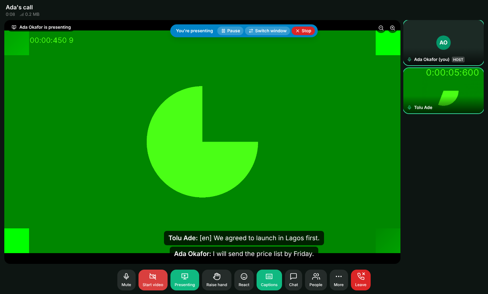
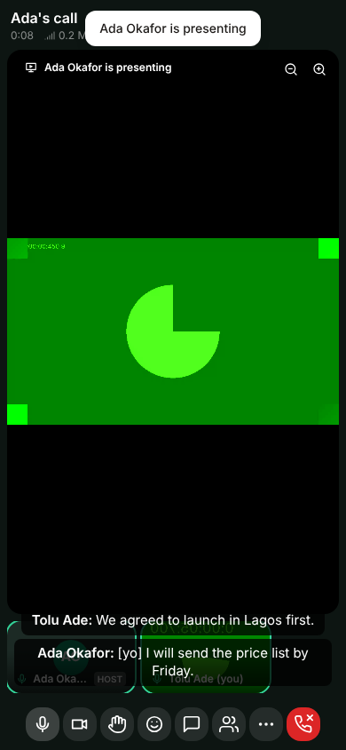
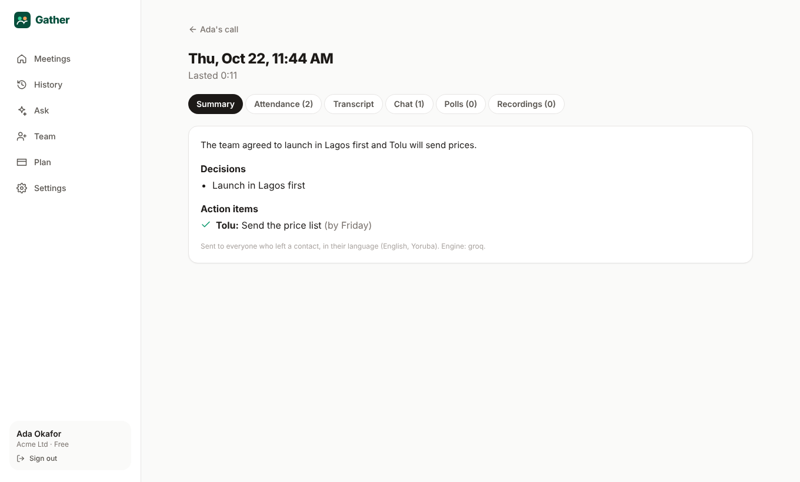

# Gather

Gather is a video meeting app for weak, expensive mobile data and many languages, starting with Africa.

- Start a call in one tap, or schedule one for another day.
- Share the link on WhatsApp. Guests join from a phone browser without an account.
- Captions are live and translated: English, Yoruba, Hausa, Igbo, Pidgin, Swahili and French.
- Every meeting ends with a summary and action items, sent to each person in their own language.

Free meetings last up to 2 hours.

| Presenting (laptop) | Guest on a phone | Summary |
|---|---|---|
|  |  |  |

## What's inside

**Meetings and invites**

- **Hosts:** passwordless sign-in (email code). Individuals or company workspaces, with team members and admins.
- **Meet now:** opens an instant room with a share sheet (WhatsApp, copy link, email, SMS).
- **Schedule:** one-off or weekly meetings with invitees.
  - Invites go out by email (with a calendar file), by WhatsApp, and optionally by SMS.
  - Each invite has RSVP buttons.
  - Reminders go out 24 hours and 15 minutes before.
  - Editing the time sends one update; cancelling sends a notice.

**Joining**

- **Guests:** enter name, WhatsApp number or email, caption language and consent.
- **Optional checks:** passcode, waiting room, email code check.

**In the call**

- **Speaking:** guests turn their camera on freely. Their mic is locked until they raise a hand and the host allows them. There are also Open mic, Allow all and Mute all.
- **Screen sharing and presenting:**
  - Hosts share any time. Any guest on a laptop or desktop can present too: they tap **Ask to present**, the host taps **Allow**, then the guest taps **Present now**.
  - Phone browsers can't share a screen, but phone guests can watch presentations.
  - One presenter at a time; the slides become the main view.
  - The presenter can pause, switch window or stop, and choose a smoother video mode.
  - Viewers can zoom.
- **Reactions:** 7 reactions (👍 👏 ❤️ 😂 🎉 🙏 😮).
- **Chat and polls:** chat for everyone; polls with live results.
- **Host controls:**
  - co-hosts and breakout rooms;
  - lock the meeting, remove someone, stop a share.
- **Data use:**
  - modes: Normal, Data saver (about 50 MB an hour) or Audio only;
  - a live data meter.
- **Captions:**
  - live, translated into each person's language;
  - optionally read aloud in your language.

**Plans and payments**

- **Free plan:** meetings last up to 2 hours, with warnings at 15 and 5 minutes before the end. Pro and Business plans have no length limit.
- **Payments:** Paystack and Flutterwave (test keys work). There is also a demo checkout so you can try upgrading with no keys.

**After the meeting**

- **Summary:** decisions and action items in each attendee's language, sent by email and WhatsApp.
- **History:** attendance list with CSV download, transcript, chat, poll results and recordings.

**Later-phase features (also included)**

- **Calendar:**
  - a subscribe link for Google, Outlook or Apple;
  - Google Calendar sync when you add Google OAuth keys.
- **Recordings:** Pro plan.
- **"Ask your meetings":** search everything that was said, with sources.
- **End-to-end encryption:** optional, per meeting.
- **Phone dial-in:** through LiveKit SIP (needs a phone number from a provider; see `docs/DIAL_IN.md`).

Native mobile apps are not included yet.

## Run it on your computer (Docker)

You need **Docker Desktop**, open and running.

1. Unzip `gather.zip` and open a terminal inside the `gather` folder.
   - VS Code: *File → Open Folder → gather*, then *Terminal → New Terminal*.
2. Check that you have a `.env` file.
   - It's included, with your Groq and Gemini keys already in it.
   - If it's missing, run `cp .env.example .env` (Windows PowerShell: `copy .env.example .env`).
3. Start everything:
   ```bash
   docker compose up --build
   ```
   The first build takes a few minutes. It's ready when the log says `Gather is running on http://localhost:8080`.
4. Open **http://localhost:8080** and click **Start free**. Enter any email address.
5. Get your 6-digit code from the test inbox at **http://localhost:8025**. All emails land there: codes, invites, reminders and summaries.
6. Click **Meet now**, then **Join now**.
7. To join as a guest, copy the meeting link and open it in a **private/incognito window** or another browser.

To stop: press `Ctrl + C`, or run `docker compose down`. Your data is kept. To also delete the data, run `docker compose down -v`.

### Testing with your phone

Phone browsers only allow the camera and mic on `https://` sites, so `http://192.168.x.x:8080` won't work for video. Two easy options:

- **Same computer:** use a second browser window (incognito) as the guest.
- **Real phone:**
  1. Create a free LiveKit Cloud project and put its URL, key and secret into `.env` (`LIVEKIT_URL=wss://…`, `LIVEKIT_API_KEY`, `LIVEKIT_API_SECRET`).
  2. Expose the app with a free tunnel such as `cloudflared tunnel --url http://localhost:8080`.
  3. Set `APP_URL` to the tunnel's https address.

## Settings (`.env`)

Everything optional switches itself off when its keys are empty.

| Setting | What it does |
|---|---|
| `GROQ_API_KEY`, `GEMINI_API_KEY` | Live captions (Groq Whisper), translation and summaries (Groq first, Gemini as backup). Without them: no captions, and a simple summary. |
| `FREE_MEETING_MINUTES` | Free plan meeting limit (default `120` = 2 hours) |
| `SMTP_*` | Real email (e.g. Gmail app password). Empty = test inbox. |
| `WHATSAPP_TOKEN`, `WHATSAPP_PHONE_NUMBER_ID` | Send WhatsApp messages automatically (Meta WhatsApp Cloud API). Without them, hosts get one-tap WhatsApp links. |
| `AT_USERNAME`, `AT_API_KEY` | SMS invites through Africa's Talking |
| `PAYSTACK_SECRET_KEY`, `FLW_SECRET_KEY`, `FLW_WEBHOOK_HASH` | Real payments. `DEMO_PAYMENTS=true` adds a fake checkout for testing. |
| `GOOGLE_CLIENT_ID/SECRET` | Google Calendar sync (redirect URI: `<APP_URL>/api/calendar/google/callback`) |
| `LIVEKIT_*` | Media server. The defaults match `deploy/livekit.yaml`. |

Payment webhook URLs to give Paystack and Flutterwave:

- `https://<your-domain>/api/billing/webhooks/paystack`
- `https://<your-domain>/api/billing/webhooks/flutterwave`

## Tests

Install Node 22 and Python 3.12 if you want to run the tests on your computer:

```bash
# Unit tests
cd server && npm install && npm test && cd ..
cd ai && python -m venv .venv && .venv/bin/pip install -r requirements.txt && .venv/bin/python -m pytest -q && cd ..

# Full end-to-end run against the stack, with a fake AI provider so results are repeatable
docker compose -f docker-compose.yml -f docker-compose.test.yml up --build -d
cd server && npx tsx test/e2e/flow.ts && cd ..                         # 30 API + real-time steps
cd tests/e2e && npm install && npx playwright install chromium && node ui.e2e.mjs && node guest-present.e2e.mjs   # 14 + 5 browser checks
```

(On Windows, use `.venv\Scripts\pip` and `.venv\Scripts\python`.)

## Project layout

```
server/   Node + TypeScript API, real-time signal (Socket.IO), scheduler, payments, notifications
  src/modules/  auth, meetings, join, rooms (in-call rules), summary, scheduler, billing, calendar, dial-in, extras
  src/lib/      LiveKit, AI client, notify (WhatsApp/email/SMS), codes, plans, time, ics
  migrations/   PostgreSQL schema
ai/       Python FastAPI: speech-to-text, translation, summaries, answers (Groq → Gemini)
web/      React + Vite + Tailwind web app (works on phones)
  src/room/     the call: LiveKit media, captions, recorder, data meter, panels
deploy/   LiveKit config
docs/     ARCHITECTURE.md, DIAL_IN.md
tests/e2e Playwright browser tests + fake AI provider
```

More detail is in [docs/ARCHITECTURE.md](docs/ARCHITECTURE.md).
